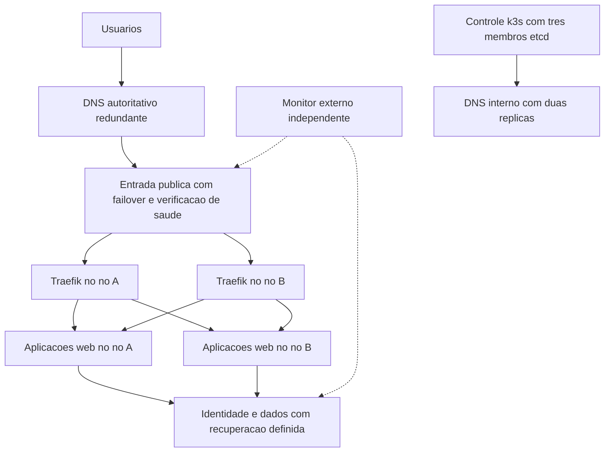

# Plano de confiabilidade e continuidade da infraestrutura RBX

Data: 18 de outubro de 2026. Horários em America/Sao_Paulo.

Estado: plano de execução proposto, baseado no incidente e nas verificações de produção desta sessão. As contenções já executadas estão identificadas na seção 3; as mudanças permanentes abaixo ainda precisam de implementação e validação.

## 1 Nome e objetivo

O nome desta sessão é **RBX Infra — Confiabilidade e Continuidade**. RBX Infra cobre servidores, Kubernetes, rede, armazenamento, identidade, capacidade e recuperação. RBXNET pode nomear a frente de rede e conectividade. RBX Server é adequado para o atendimento de uma máquina específica, mas não representa o alcance deste incidente.

O objetivo é reduzir a probabilidade de esgotamento de recursos e impedir que a perda de um nó de computação interrompa todos os sites. A recuperação deve ser mensurável, com procedimentos reproduzíveis e alertas que continuem funcionando durante a falha.

O planejamento inclui os sites RBX, o frontend do Robson e as dependências necessárias para seu funcionamento. Banco de dados, identidade, execução do motor do Robson e pagamentos têm requisitos próprios de consistência e recuperação; a disponibilidade da página de login não comprova a disponibilidade dessas operações.

## 2 Decisões propostas

1. Ter pelo menos duas instâncias saudáveis de Traefik e CoreDNS, em nós distintos, e distribuir as réplicas dos serviços HTTP críticos.
2. Dimensionar a capacidade para suportar a perda de um nó elegível, incluindo recursos do sistema, picos e inicialização de aplicações.
3. Reservar CPU e memória para o sistema e o k3s e corrigir solicitações de recursos das aplicações.
4. Retirar do IP do tiger a responsabilidade exclusiva pela entrada pública.
5. Manter detecção e notificação externas ao domínio de falha do cluster.
6. Dar a cada volume persistente uma estratégia de disponibilidade, backup e restauração compatível com o serviço.
7. Aplicar mudanças por etapas e encerrar cada etapa somente com evidência do comportamento esperado.

A disponibilidade de um nó não será tratada como sinônimo de disponibilidade da aplicação. A aceitação deve percorrer DNS, TCP, TLS, HTTP, arquivos do frontend, autenticação e dependências de estado, conforme o fluxo avaliado.

## 3 Incidente e estado de partida

### Mecanismo observado

Em 18 de outubro, o sumatrae deixou de atualizar o estado do nó; a condição NotReady foi registrada aproximadamente às 12h51. A única instância do Traefik estava nesse nó e deixou de oferecer um endpoint pronto. Os domínios continuavam apontando para tiger, mas a entrada desse nó dependia do Traefik indisponível.

Havia uma réplica saudável do frontend do Robson no altaica. Ela não bastou para manter o acesso público porque a entrada era compartilhada. DNS público respondeu com o endereço esperado; as conexões HTTP/HTTPS expiravam antes de chegar às aplicações.

Durante o diagnóstico, sumatrae apresentou carga de aproximadamente 56, menos de 500 MiB de memória disponível e forte pressão de CPU, memória e I/O. Antes da remoção dos pods, os pedidos de memória no nó somavam 7.411 MiB, enquanto o processo k3s chegou a consumir aproximadamente 1,8 GiB. O nó oferecia praticamente toda a memória física como Allocatable.

Esses dados demonstram sobrecarga e falta de margem operacional durante o incidente. O gatilho inicial ainda deve ser apurado: reconstruir a sequência de reinícios, atualizações, mudanças de aplicações e crescimento de consumo, sem atribuir automaticamente o evento a uma atualização ou a uma aplicação específica.

### Linha do tempo comprovada

| Momento aproximado | Evidência ou ação |
|---|---|
| 12h51 | sumatrae reconhecido como NotReady; endpoint do Traefik deixa de estar pronto. |
| 12h56 | Kubernetes agenda um novo Traefik no tiger após a remoção automática do pod antigo. |
| 13h01 | Os quatro endereços públicos testados respondem HTTP 200. |
| 13h02 a 13h04 | sumatrae recebe cordon, k3s é reiniciado, pods antigos são encerrados e o nó volta a Ready. |
| Cerca de 13h15 | Monitoramento recuperado com exceções de agendamento somente nos cinco pods pendentes. |

O início exato de toda a indisponibilidade não foi determinado. Esses horários descrevem a parte observada e as ações desta sessão.

### Contenções executadas

- Recuperação automática do Traefik e das aplicações no tiger acompanhada até o retorno público.
- Reinício do serviço k3s somente no sumatrae, após verificar os outros dois nós de controle e a prontidão da API.
- sumatrae mantido em Ready com SchedulingDisabled.
- Exceção para agendamento adicionada aos pods atuais de Prometheus, Alertmanager, Grafana, Loki e cache do Loki. Os volumes dos quatro primeiros estão vinculados ao sumatrae; o cache não possui PVC.
- Verificação HTTP 200 de Prometheus, Alertmanager e Loki em seus endpoints de prontidão, com os cinco pods do monitoramento prontos. A entrega de notificações a destinatários não foi testada.
- Sites, frontend e endpoints de saúde/prontidão da API Robson respondendo HTTP 200; tela de login do Robson e arquivos JavaScript verificados.

As exceções do monitoramento não estão nos templates dos controladores e desaparecem quando esses pods são substituídos. Elas não constituem configuração permanente. As tolerâncias já existentes nos DaemonSets são comportamento separado e não devem ser removidas como se fossem exceções desta intervenção.

### Topologia e concentração atuais

| Nó ou serviço | Recursos e papel observados | Restrição relevante |
|---|---|---|
| tiger | 4 vCPU, cerca de 8 GB; controle, etcd e aplicações; 72 pods ativos na captura posterior | Entrada pública de todos os domínios testados; recebeu grande parte da carga removida do sumatrae. |
| altaica | 4 vCPU, cerca de 8 GB; controle, etcd e aplicações; 38 pods ativos | Estado local de pagamentos, ClickHouse e ZooKeeper. |
| sumatrae | 4 vCPU, cerca de 8 GB; controle e etcd; 8 pods ativos na captura posterior | Cordon; monitoramento e ZooKeeper têm volumes locais vinculados ao nó. |
| jaguar | 8 vCPU, cerca de 24 GB; banco externo e analytics; 3 pods ativos | Taint de dedicação a analytics; RAM livre não é capacidade geral aprovada. |
| bengal | 4 vCPU, cerca de 8 GB; agente; 3 pods ativos | Taint de piloto Ubuntu 26.04; requer avaliação e adesão explícita das cargas. |
| pantera e eagle | DNS autoritativo externo ao k3s, conforme inventário | A redundância do DNS autoritativo não remove a dependência do IP único da entrada web. |
| lince | Correio externo ao k3s, conforme inventário | Dependência do caminho atual de notificações. |

Na captura, todos os cinco nós Kubernetes estavam Ready. Traefik e CoreDNS continuavam com uma réplica cada, no tiger. As aplicações web RBX e o frontend do Robson tinham duas réplicas entre tiger e altaica. Robsond e Redis do Robson tinham uma réplica cada.

Os pedidos declarados de recursos dos nós de controle, após a recuperação, estavam assim:

| Nó | Pedidos de CPU | Pedidos de memória | Leitura operacional |
|---|---|---|---|
| altaica | 3.910m, cerca de 97% | 7.910 MiB, cerca de 99% | Praticamente sem espaço de agendamento antes de reservar recursos do host. |
| tiger | 3.690m, cerca de 92% | 6.102 MiB, cerca de 76% | Alta concentração após a transferência das aplicações. |
| sumatrae | 740m, cerca de 18% | 2.125 MiB, cerca de 26% | Capacidade preservada pelo bloqueio e pela recuperação seletiva do monitoramento. |

Esses percentuais representam pedidos declarados, não consumo real. Também não incluem todos os processos do host, e os contêineres sem pedido tornam a conta incompleta. Portanto, corrigir pedidos, adicionar réplicas e reduzir Allocatable exige validar o destino antes de cada mudança.

Faltavam pedidos de memória em contêineres de ArgoCD, cert-manager, external-secrets, Traefik, Langfuse, identidade e componentes auxiliares do monitoramento. O inventário de capacidade deve incluir também esses contêineres, os init containers e os processos fora dos pods.

O [runbook de migração HA](runbooks/K3S-HA-MIGRATION.md) já previa redundância de Traefik e CoreDNS. O estado observado mostra que esse objetivo não está efetivado. O [plano de robustez de julho](infra/P1-CLUSTER-ROBUSTNESS-2026-07-08.md) também registra riscos de armazenamento e observabilidade. Este plano consolida a execução restante, sem transformar o encerramento histórico da migração em prova de disponibilidade das aplicações.

## 4 Metas de serviço e recuperação

As metas abaixo são propostas para validação pelo operador e pelos responsáveis dos produtos. Tornam-se capacidade comprovada somente depois dos testes correspondentes.

| Serviço ou evento | Meta proposta | Como demonstrar |
|---|---|---|
| Sites institucionais e carregamento do frontend Robson | Disponibilidade mensal de 99,95%, incluindo falhas de manutenção percebidas pelos usuários | Medição externa de DNS, TLS, HTML e arquivos críticos. Em 30 dias, orçamento de aproximadamente 21,6 minutos de indisponibilidade. |
| Perda de um nó de computação para os sites | Restabelecer tráfego em até 60 segundos, sem intervenção manual, após concluir a redundância da entrada | Testar separadamente perda de Traefik, do host público e de um worker; sondagem externa contínua. |
| API e autenticação | Meta inicial de 99,9%; recuperação de instância HTTP sem estado em até 5 minutos | Fluxo autenticado sintético e chamadas de leitura seguras. A meta completa depende da disponibilidade do banco e do provedor de identidade. |
| Detecção de indisponibilidade pública | Até 2 minutos | Verificação externa a cada 30 segundos, confirmação por múltiplas amostras e medição do recebimento do alerta. |
| Recuperação do controle após perda de um servidor etcd | API operacional com os dois membros restantes; nó recuperado ou substituído em até 30 minutos | Teste serializado de falha de um único membro, saúde do etcd e acesso administrativo alternativo. |
| Recuperação de desastre do estado do cluster | RPO de até 1 hora e RTO de até 2 horas | Snapshot externo e restauração em ambiente isolado, incluindo material necessário para abrir o backup. |
| Banco de dados após perda do host | RPO proposto de até 15 minutos e RTO de até 60 minutos | Restauração externa com WAL e reconciliação das aplicações; depende da comprovação do backup e da capacidade de reposição. |
| Estado de ordens e pagamentos | Recuperar e reconciliar sem execução duplicada | Critério específico dos produtos. O RPO genérico de banco não autoriza perder ou repetir uma operação externa confirmada. |

RPO mede a perda máxima de dados; RTO mede o tempo para recuperar o serviço. Snapshot de etcd não substitui backup de PostgreSQL nem dos dados em PVCs.

## 5 Arquitetura pretendida



Os nós A e B precisam ser elegíveis e ter capacidade disponível. Hospedar dois proxies no mesmo host ou dois componentes de estado no mesmo domínio de falha não satisfaz a redundância proposta. A localização física e a independência de provedor das VPSs precisam ser verificadas antes de afirmar tolerância à perda de um datacenter ou de uma conta.

O alvo é manter três servidores de controle e um conjunto de workers de produção aptos a receber as aplicações. O dimensionamento e a quantidade de workers serão definidos pelo teste de capacidade N menos 1, em vez de simplesmente contar toda a RAM existente na frota.

## 6 Frente de entrada web e DNS

### Traefik e CoreDNS

1. Configurar duas réplicas prontas de cada componente, com distribuição entre hosts elegíveis e recursos declarados.
2. Para o Traefik empacotado pelo k3s, usar HelmChartConfig versionado. Identificar também o mecanismo de configuração suportado para o CoreDNS na versão instalada. Não editar arquivos que o k3s regenera no boot. [Configuração de componentes empacotados](https://docs.k3s.io/add-ons/helm).
3. Escolher uma regra de distribuição que mantenha as réplicas separadas e ainda permita atualizações com o número de nós disponível. Verificar conjuntamente afinidade, topology spread, taints, estratégia de rollout e capacidade para uma réplica adicional. [Distribuição de pods](https://kubernetes.io/docs/concepts/scheduling-eviction/topology-spread-constraints/).
4. Definir prioridade para infraestrutura crítica sem atribuir a mesma prioridade a todas as aplicações. Validar o efeito de preempção antes de ativá-la.
5. Configurar PDB para manutenção voluntária e estratégia de atualização do próprio Deployment. PDB não impede perda abrupta de nó nem substitui redundância; também não governa o rollout feito pelo Deployment. [Limites dos disruption budgets](https://kubernetes.io/docs/concepts/workloads/pods/disruptions/).
6. Ajustar startup e readiness para inicialização sob carga. Liveness deve identificar travamento real, evitando reinícios em cascata por indisponibilidade transitória de uma dependência.

Aceite: duas réplicas em hosts distintos, ao menos uma pronta durante substituição de pod, DNS interno respondendo continuamente e nenhum redirecionamento, certificado ou arquivo estático quebrado nos sites.

### Entrada pública sem dependência exclusiva do tiger

O ServiceLB do k3s pode publicar portas em vários nós, mas isso não altera automaticamente os registros DNS usados pelos clientes. Por isso, duas réplicas de Traefik ainda deixam uma falha de entrada se todos os usuários chegarem ao IP de um host desligado. [Funcionamento do ServiceLB](https://docs.k3s.io/networking/networking-services).

A decisão de arquitetura deve comparar:

| Opção | Uso proposto | Condição de aceite |
|---|---|---|
| Balanceador externo com disponibilidade própria | Opção preferida se o provedor ou serviço contratado atender às metas | Verificações por host e nome de serviço, exclusão automática de destino falho, TLS e WebSocket compatíveis, custos e dependências registrados. |
| Dois proxies externos com mecanismo de failover suportado | Alternativa quando houver capacidade operacional e suporte de rede | A perda de qualquer proxy ou endereço não deixa a entrada sem atendimento; não criar um novo proxy único. |
| Failover por DNS com verificações de saúde | Alternativa intermediária se o comportamento dos clientes for aceitável | Medir caches e TTL reais. Não afirmar a meta de 60 segundos antes de um teste externo com clientes representativos. |

Não adotar somente múltiplos registros A sem verificação de saúde como prova de failover. Também não presumir que um endereço virtual se move entre VPSs ou redes sem suporte do provedor.

Antes da mudança: testar cada destino com o nome TLS correto, inventariar A, AAAA, CNAME e os subdomínios críticos, conferir renovação ACME, definir onde TLS termina e preservar o endereço de retorno. Se a terminação for externa, manter criptografia e validação até a origem e definir a confiança em cabeçalhos encaminhados.

Durante a transição: reduzir TTL com antecedência de pelo menos o TTL vigente, medir resultados, manter o caminho anterior durante a propagação e testar IPv4 e IPv6 quando publicados. Não copiar um AAAA antigo que contorne o novo balanceador.

Aceite: desligar o caminho do tiger de forma controlada e continuar acessando os sites por fora da rede RBX; repetir com outro destino. A passagem do certificado TLS, isoladamente, não comprova saúde do backend.

## 7 Frente de recursos e capacidade

### Medição e proteção do host

Coletar pelo menos sete dias de uso, incluindo reinícios e picos; a cobertura emergencial das primeiras 24 horas deve orientar as primeiras mudanças. Medir memória de trabalho dos contêineres, consumo do k3s e do runtime, CPU, pressão PSI, disco, inodes, latência de I/O e latência do etcd.

Separar três valores por aplicação: solicitação usada para agendamento, limite de memória e consumo observado. Um pedido muito abaixo do uso permite concentração excessiva; um limite arbitrariamente pequeno provoca encerramentos por falta de memória. Para CPU, definir pedidos coerentes e avaliar limites conforme latência e perfil do serviço.

Usar kubeReserved e systemReserved para preservar os processos fora dos pods. Nos servidores atuais de aproximadamente 8 GB, avaliar inicialmente uma reserva combinada de 2,5 a 3 GiB de RAM e 0,5 a 1 vCPU, ajustada às medições. Esses valores são uma hipótese de dimensionamento RBX, não configuração já aprovada. A referência técnica é a [reserva de recursos do Kubernetes 1.36](https://v1-36.docs.kubernetes.io/docs/tasks/administer-cluster/reserve-compute-resources/).

A aplicação das reservas começa somente quando a carga existente couber na nova capacidade ou tiver destino de migração. Iniciar a proteção de Allocatable sobre os pods; não impor limites rígidos novos aos cgroups do sistema sem perfil e recuperação testados. Configurar a retirada preventiva de pods por pressão de memória, preservando também os limiares de disco e inodes. Um perfil inicial a testar pode usar aviso de memória disponível abaixo de 20%, retirada preventiva antes do esgotamento e um limiar duro de referência de 500 MiB; a configuração final deve considerar a velocidade de crescimento do consumo.

### Pedidos de recursos e distribuição

- Corrigir primeiro Traefik, ArgoCD, identidade, Langfuse, cert-manager e external-secrets, incluindo seus componentes auxiliares.
- Inventariar workloads com pedidos ausentes, limites inadequados, repetição de reinícios ou picos de inicialização.
- Aplicar LimitRange e ResourceQuota gradualmente, por namespace, com exceções explícitas e testes para Jobs, inicialização e rollouts. Evitar valores padrão que apenas escondam pedidos incorretos.
- Estabelecer limites de concorrência para tarefas, backfills, builds e CronJobs; usar política de concorrência, prazo de execução e limpeza dos Jobs concluídos conforme a carga.
- Separar sandbox, experimentos, analytics e processamento pesado das réplicas que sustentam os sites e a identidade.
- Usar as restrições declaradas do jaguar e do bengal. A adoção do bengal exige revalidar o piloto e seus controles; não retirar o taint apenas porque existe RAM livre. Consultar [ADR do piloto](adr/ADR-0010-bengal-ubuntu-2604-pilot.md).

### Teste de capacidade N menos 1

Para cada nó elegível cuja falha será tolerada, calcular CPU e memória remanescentes depois das reservas e verificar se a carga crítica, seus pedidos e o pico de recuperação cabem nos nós restantes. O teste também precisa considerar afinidade, portas e volumes; somar RAM não demonstra que os pods podem ser agendados.

Como margem inicial de planejamento, reservar 20% para recuperação e crescimento dentro da capacidade remanescente, revisada após medir os picos. Se uma única perda tornar a carga crítica impossível de agendar, adicionar capacidade aprovada, realocar cargas não críticas ou reduzir sua concorrência antes de promover a configuração.

Uma estimativa inicial mostra a ordem do problema: os três nós de controle somavam cerca de 15,76 GiB de pedidos de memória. Reservar 2,5 GiB por host deixaria aproximadamente essa mesma capacidade para pods no conjunto dos três, sem margem. A perda de um desses hosts reduziria essa capacidade para aproximadamente 10,5 GiB. O conjunto atual dessas cargas não cabe nesse cenário. O dimensionamento final deve distinguir a carga crítica das cargas que podem ser suspensas e incluir os pedidos ainda ausentes.

A compra de workers deve ser dimensionada por esse resultado. A decisão deve comparar aproveitar um worker já homologado, ampliar capacidade ou acrescentar workers de produção. Manter pelo menos dois destinos elegíveis para os serviços replicados e considerar a perda do maior destino, não somente a perda de um host pequeno.

Aceite: nenhuma aplicação crítica depende de pedidos de memória ausentes; o host conserva margem para controle e acesso administrativo; o cenário de perda de um nó passa sem nova pressão sustentada nos sobreviventes.

## 8 Frente de monitoramento e notificação

Manter Prometheus, Grafana, Loki e Alertmanager como observabilidade interna e implantar uma verificação externa independente do cluster, do login RBX e da mesma conta de infraestrutura. Ela deve continuar detectando falhas mesmo quando Prometheus ou Alertmanager estiverem indisponíveis.

A verificação externa acompanha DNS, conexão, TLS, resposta HTTP e um marcador esperado do conteúdo. Para Robson, incluir carregamento da tela de login e dos arquivos de aplicação, além de saúde/prontidão da API. Fluxos autenticados usam conta sintética restrita e não executam ordens, pagamentos ou operações reais.

### Cobertura inicial de alertas

Os valores abaixo são pontos de partida RBX para calibração durante sete dias, não limites universais.

| Sinal | Regra inicial proposta | Ação esperada |
|---|---|---|
| Falha pública de DNS, TLS ou HTTP | Sondagem a cada 30 s; confirmar falha persistente e corroborar de outro ponto quando disponível; detectar em até 2 min | Acionar operador com host, etapa falha e última resposta válida. |
| Zero endpoints prontos de Traefik, CoreDNS ou serviço crítico | Criticidade alta após 30 a 60 s, conforme tempo de coleta | Investigar entrada, distribuição e recuperação; não esperar dez minutos para esses serviços. |
| Apenas uma réplica pronta de um serviço cuja meta é duas | Aviso após 5 min, crítico se coexistir perda de nó ou falha pública | Restaurar redundância antes de nova manutenção. |
| Nó NotReady ou lease sem atualização | Criticidade alta após 60 s | Confirmar quorum e transferir atendimento para os sobreviventes. |
| Memória disponível | Aviso abaixo de 20% por 5 min; crítico abaixo de 10% por 2 min | Reduzir carga não crítica e investigar crescimento. |
| Pressão de memória PSI e CPU | Investigar memória full acima de 1% por 3 min e acima de 5% por 1 min; correlacionar CPU sustentada, pressão e latência | Agir antes da perda do kubelet; calibrar ruído e exceções. |
| OOM, reinícios e pods críticos pendentes | OOM crítico: investigar imediatamente; Pending crítico além do tempo de inicialização esperado | Identificar limite, capacidade ou PVC bloqueador. |
| Disco, inodes e I/O do etcd | Limiares por host e crescimento previsto | Evitar falha de gravação e latência que afete quorum. |
| Certificado, backup e replicação | Aviso de expiração com antecedência; atraso acima do RPO definido | Corrigir antes de comprometer serviço ou recuperação. |
| Falta de sinal do próprio monitoramento | Heartbeat externo ausente por até 2 min | Acionar caminho de notificação independente. |
| GitOps degradado ou divergente | Alerta por criticidade e duração; separar divergência reconhecida de regressão nova | Atribuir responsável e prazo de resolução. |

Validar as consultas contra as métricas realmente coletadas. Há regras existentes baseadas em Endpoints; verificar se continuam corretas com a versão instalada e se a cobertura de EndpointSlices está presente antes de substituí-las.

Conservar agrupamento, deduplicação, inibição e mensagens de resolução. O caminho atual de e-mail passa por serviços RBX; validar o recebimento e escolher um segundo caminho independente com o operador. Os conceitos de roteamento e alta disponibilidade constam na [documentação do Alertmanager](https://prometheus.io/docs/alerting/latest/alertmanager/).

Aceite: falha simulada é detectada e recebida pelo responsável dentro da meta; desligar o monitoramento interno também gera sinal externo. Configuração de destinatário, isoladamente, não comprova entrega.

## 9 Frente de armazenamento e recuperação de dados

### Classificação obrigatória por volume

Cada PVC deve registrar serviço, host atual, conteúdo, criticidade, tolerância a perda, backup, restauração, RPO/RTO e responsável. A captura identificou volumes locais de monitoramento no sumatrae, de pagamentos e ClickHouse no altaica, de Redis e ZooKeeper no tiger e de analytics no jaguar.

| Classe | Tratamento proposto |
|---|---|
| Cache reconstruível | Confirmar a semântica com o responsável e permitir reconstrução com tempo e carga medidos. |
| Métricas e logs de operação | Definir retenção e continuidade da detecção; avaliar envio externo e armazenamento adequado. |
| Dashboards e configuração | Versionar configuração e testar reconstrução; preservar dados que não sejam reconstruíveis. |
| Banco, identidade, ordens, pagamentos e chaves | Backup consistente, recuperação comprovada e política específica de consistência e acesso. |
| Blockchain e dados de indexação | Distinguir dados regeneráveis de configuração, carteira e estado de pagamento que precisam ser preservados. |

Um PVC local não acompanha automaticamente um pod para outro host; sua afinidade restringe o agendamento. Isso explica parte dos pods pendentes após a contenção. [Volumes locais e afinidade](https://kubernetes.io/docs/concepts/storage/volumes/#local).

### Decisão de armazenamento

Para cada serviço, escolher explicitamente entre estado externo, armazenamento replicado suportado, ou armazenamento local com restauração e indisponibilidade aceitas. Replicação requer capacidade adicional de disco, rede e operação; não instalar uma camada distribuída em hosts já sem margem como primeira resposta ao incidente.

Manter PostgreSQL de produção fora do k3s conforme a [arquitetura de banco](infra/DATABASE.md). Avaliar réplica de PostgreSQL e promoção controlada como decisão própria de disponibilidade, sem confundir réplica com backup. A perda do jaguar permanece um risco a tratar mesmo depois de tornar o frontend redundante.

### Backup e testes

1. Verificar o estado instalado do pgBackRest e do arquivamento de WAL. O [ADR de backup](adr/ADR-0012-pgbackrest-cluster-backup-jaguar.md) e o [runbook existente](runbooks/PGBACKREST-BACKUP.md) descrevem implantação e destino externo; a existência desses documentos não comprova execução atual.
2. Verificar snapshots de etcd, cópia e idade do último backup. O repositório configura snapshots a cada seis horas e cópia tiger para jaguar; essa cópia, sozinha, não cobre perda da conta ou do provedor.
3. Para a meta proposta de RPO do cluster, avaliar snapshots horários com retenção local suficiente para 48 horas e retenção externa por política de custo e recuperação. Preservar cadeias verificadas durante a transição.
4. Guardar o token original e os demais materiais de recuperação por referências seguras no inventário de recuperação. A restauração de um snapshot k3s em outro host depende do token original para abrir os dados de bootstrap. [Restauração de snapshots k3s](https://docs.k3s.io/cli/etcd-snapshot).
5. Manter cópia externa a outra conta e outro provedor, com retenção protegida contra remoção pelas credenciais do host de origem. Confirmar contratação e funcionamento do destino aprovado, sem presumir que ele já existe.
6. Restaurar banco, volume e cluster em ambiente isolado antes de executar migrações de estado. Medir RPO/RTO e validar a aplicação, não apenas a presença dos arquivos.

Backups de dados, configurações e materiais de acesso precisam formar uma cadeia utilizável sem o cluster funcionando. Registrar evidências no fluxo existente de rbx-resilience, respeitando seus critérios de execução, validação e custódia. Não promover estados de auditoria manualmente nem declarar uma capacidade comprovada somente por um documento ou manifesto.

Aceite: cada dado não regenerável tem restauração testada, responsável e dependências conhecidas; o teste não depende exclusivamente do mesmo host, provedor, conta ou login que se pretende recuperar.

## 10 Frente de identidade e execução segura das aplicações

Mapear as dependências dos fluxos públicos: frontend, API, sessão, identidade, PostgreSQL, Redis, filas e serviços externos. Testar os fluxos separadamente e identificar quais componentes podem ter múltiplas réplicas sem coordenação adicional.

Para serviços HTTP sem estado, validar sessões compartilhadas, chaves consistentes, limites de conexão ao banco e encerramento gracioso. Para dados, confirmar persistência e semântica de recuperação antes de mudar quantidade ou posição das instâncias.

O motor do Robson não deve ser duplicado como se fosse um frontend. Antes de qualquer operação com múltiplas instâncias, verificar liderança exclusiva, impedimento de escritor antigo continuar operando, idempotência e reconciliação. A restauração do controle deve incluir confirmação de que só a instância autorizada pode produzir efeitos. Aplicar o mesmo cuidado a consumidores de filas e processadores de pagamentos.

Aceite: perder um pod web mantém o fluxo de usuário; recuperar um componente com efeitos externos não cria execução duplicada. Os testes usam leitura ou ambiente de teste e não enviam ordens nem cobranças reais.

## 11 Frente de operação e gestão de mudanças

### Recuperação e acesso administrativo

Manter duas formas verificadas de acesso operacional, com host keys fixadas e credenciais tratadas no fluxo existente. A recuperação não pode depender exclusivamente do login que roda dentro do cluster. Validar também acesso ao console do provedor e disponibilidade do material de recuperação por pessoas autorizadas.

Registrar reinícios, versões, alterações de agendamento e manutenção do provedor. Apurar se os reinícios observados foram manuais, automáticos ou externos. Preservar atualizações de segurança e organizar seus reinícios: um único nó de controle por vez, quorum saudável, margem de capacidade e pós-verificação antes do próximo nó.

### GitOps e validação

- Ansible: configuração do host, reservas, serviços e rotinas de backup.
- GitOps: réplicas, distribuição, recursos, alertas e configuração Kubernetes persistente.
- Terraform: registros DNS no escopo já estabelecido pelo repositório.
- rbx-resilience: evidência de recuperação e validação de capacidade demonstrada.

Cada mudança deve indicar problema, antes/depois, validação, impacto e caminho de reversão. Manter alterações pequenas por frente. Não executar uma sincronização geral para resolver indiscriminadamente todas as divergências existentes.

Ampliar a validação de CI para exigir recursos nos workloads definidos como críticos, distribuição das réplicas essenciais, configuração persistente do Traefik, referências válidas de PVC e imagens disponíveis. Validar o YAML renderizado e as regras de alerta. Usar a configuração da versão instalada; exemplos de versões históricas não servem como comando pronto para produção.

Adicionar uma verificação de estado real depois da mudança: réplicas em hosts distintos, endpoints prontos, alertas ativos, capacidade remanescente e testes HTTP externos. Um manifesto com duas réplicas ou uma aplicação Synced não comprova funcionamento.

### Manutenção de estado local

Antes de cordon, reinício, drain ou troca de host, listar os PVCs vinculados e o procedimento aplicável. O runbook atual de pagamentos determina cuidado específico com altaica e estado local. Não fazer drain genérico como passo padrão nem forçar remoção de pods ou volumes para satisfazer um indicador de saúde.

Atualizar os runbooks existentes com o resultado das novas etapas, preservando as notas históricas e retirando ambiguidades entre plano, ação executada e aceitação demonstrada.

## 12 Transição da contenção do sumatrae

O cordon atual preserva capacidade, mas as cinco exceções manuais de pods precisam ser substituídas antes de uma nova recriação do monitoramento.

Procedimento proposto para a primeira janela, caso o nó continue estável e a revisão de capacidade permita:

1. Registrar as exceções atuais, seus controladores, PVCs e condição de prontidão. Confirmar memória, etcd e os outros nós de controle.
2. Criar uma restrição de manutenção própria com NoSchedule e uma identificação de responsável e revisão. Essa restrição permanece quando o cordon genérico for retirado.
3. Versionar tolerâncias específicas a essa restrição somente nos componentes de monitoramento autorizados, mantendo a afinidade dos seus volumes. Não incluir tolerância genérica ao bloqueio de qualquer nó nos templates de produção.
4. Retirar o cordon somente depois de verificar a nova barreira de manutenção e o estado desejado dos controladores. Assim, os pods autorizados podem ser recriados, enquanto as cargas gerais continuam excluídas.
5. Substituir os pods antigos de modo controlado, um componente por vez, para eliminar as exceções temporárias. Preservar PVCs e medir replay, prontidão e uso de recursos.
6. Retirar a restrição própria apenas quando a capacidade, as reservas e a distribuição estiverem aprovadas. Conferir novamente todos os serviços que usam estado no nó.

Se essa transição não puder ocorrer imediatamente, a exceção continua como pendência operacional com responsável e revisão diária. Recuperar novamente os mesmos pods em um incidente não encerra essa pendência.

## 13 Sequência de entrega

D0 é o início autorizado da implementação. As janelas abaixo são estimativas de planejamento, não agendamentos criados. Contratação, migração de dados e disponibilidade do operador podem ampliar o calendário.

| Etapa | Prazo proposto | Entrega | Responsável funcional | Dependência e aceite |
|---|---|---|---|---|
| 0 | D0, primeiras 4 horas | Captura de estado, pendências e investigação do gatilho; preservar evidências | Operador de infraestrutura | Registrar nós, recursos, volumes, versões, divergências e sintomas sem segredos. |
| 1 | D0 a D1 | Continuidade do monitoramento e saída das exceções manuais | Infraestrutura e observabilidade | Capacidade do sumatrae validada; recriação dos cinco componentes funciona sem intervenção em pods individuais. |
| 2 | D0 a D3 | Traefik e CoreDNS redundantes e configuração persistente | Infraestrutura | Verificação de capacidade da etapa 3 antes de aplicar; duas réplicas saudáveis em hosts distintos e rollout validado. |
| 3 | D1 a D3 | Perfil de uso, pedidos corrigidos e decisão de capacidade | Infraestrutura e responsáveis das aplicações | Incluir estado, init containers, componentes auxiliares e picos de inicialização; determinar necessidade de workers. |
| 4 | D2 a D5 | Redistribuição e reservas nos hosts | Infraestrutura | Destinos homologados e capacidade suficiente; executar um servidor de controle por vez. |
| 5 | D1 a D5 | Sondagem externa e entrega de alertas comprovada | Observabilidade e operador | Destino autorizado e independente; falha pública e perda de monitoramento interno detectadas na meta. |
| 6 | D3 a D10 | Entrada pública com failover | Infraestrutura e rede | Decisão de opção, custo, TLS e DNS; teste real de perda do tiger sem interrupção além da meta. |
| 7 | D3 a D10 | Inventário de estado e provas de backup e restauração | Infraestrutura e responsáveis dos dados | RPO/RTO por componente; dados críticos recuperados fora da origem. |
| 8 | D5 a D15 | Retirar dependências locais que bloqueiam as metas escolhidas | Infraestrutura e responsáveis dos produtos | Plano de migração, cópia verificada e reversão ensaiada para cada volume ou banco. |
| 9 | D10 a D15 | Exercícios de falha e encerramento das pendências | Operador com revisão técnica | Testes abaixo aprovados, contingências removidas e riscos restantes aceitos explicitamente. |
| 10 | D15 a D30 | Acompanhamento e ajuste dos limites e metas | Infraestrutura e observabilidade | Uso e alertas estáveis durante sete dias; relatório de capacidade e erros após 30 dias. |

As etapas podem preparar código em paralelo, mas alterações de produção devem respeitar dependências e limites de impacto. Não reduzir Allocatable antes de a carga caber, nem combinar migração de estado com mudança de entrada na mesma janela.

### Pacotes de mudança revisáveis

1. Baseline e ferramentas de diagnóstico: relatório sem segredos, inventário e lista de riscos.
2. Traefik e CoreDNS: configuração, distribuição, recursos e validação de rollout.
3. Recursos das aplicações: lotes pequenos por produto e componente de plataforma.
4. Capacidade e reservas: inventário, homologação de worker e alteração Ansible por canário.
5. Monitoramento: restrição de manutenção, estado, regras, sondagem externa e teste de notificação.
6. Entrada pública: decisão de arquitetura, configuração, DNS e retorno.
7. Dados e recuperação: um pacote por componente com estado.
8. Verificação de continuidade: testes, evidências e atualização de runbooks.

Os papéis acima precisam de titulares e substitutos antes da execução. O operador decide janela, orçamento e promoção; os responsáveis dos produtos validam consistência e critérios funcionais; a revisão técnica confere evidências e limites de reversão.

## 14 Testes de aceitação e limites de impacto

Executar testes de falha primeiro em ambiente isolado. A passagem para produção exige entrada redundante, capacidade remanescente, backup utilizável para o estado envolvido e uma janela com operador disponível. Nunca interromper dois membros do etcd no mesmo exercício.

| Exercício | Resultado esperado | Evidência exigida |
|---|---|---|
| Substituir um pod do Traefik | Outra instância permanece pronta e os sites continuam acessíveis | Distribuição por host, endpoints e série de sondagem HTTP externa. |
| Substituir um pod CoreDNS | Resolução interna continua atendendo | Consultas repetidas por um workload de teste e erros DNS das aplicações. |
| Retirar o caminho público do tiger | Tráfego segue para outro destino dentro da meta | Health checks do balanceador, testes externos IPv4/IPv6 publicados e tempo observado. |
| Perder um worker de aplicações | Réplicas atendem sem esgotar os sobreviventes | Capacidade, filas, latência e prontidão durante a recuperação. |
| Perder um servidor de controle | Quorum de dois permanece operacional | Saúde da API e do etcd, sem segundo reinício até a recuperação do primeiro. |
| Simular pressão de recursos | Detecção antes da falha de acesso ou heartbeat | Teste restrito em ambiente de teste; sequência de alertas, pressão e recuperação. |
| Indisponibilizar monitoramento interno | Sondagem e notificação externas continuam funcionando | Horários de falha, detecção e recebimento por destinatário autorizado. |
| Recriar o monitoramento | Componentes sobem sem exceções aplicadas em pods individuais | Estado dos controladores, PVCs, prontidão e replay de dados. |
| Restaurar banco e estado | Aplicação usa dados coerentes dentro do RPO/RTO | Restauração isolada, horário do último dado e validação funcional. |
| Restaurar snapshot do cluster em ambiente isolado | Recursos e dependências essenciais podem ser reconstruídos | Snapshot identificado, custódia válida e teste de acesso sem a infraestrutura original. |
| Recuperar componente do Robson ou pagamentos | Nenhuma execução externa duplicada | Teste em ambiente apropriado, exclusividade e reconciliação demonstradas. |

Interromper o exercício se a API perder prontidão, o quorum ficar em risco, o serviço público ultrapassar a janela combinada, ocorrer pressão sustentada nos sobreviventes ou existir dúvida sobre integridade de estado. Preservar evidência e voltar ao último estado funcional antes de continuar.

## 15 Reversão por tipo de mudança

| Mudança | Preparação | Caminho de reversão e limite |
|---|---|---|
| Réplicas, distribuição e recursos | Guardar revisão e configuração efetiva; verificar capacidade para o rollout | Reverter somente a revisão afetada, mantendo ao menos uma instância funcional. Se a regra de distribuição bloquear atualização, revisar também a estratégia de rollout. |
| Reservas do kubelet ou k3s | Captura da configuração, acesso administrativo e dois membros de controle saudáveis | Recuperar a configuração anterior no canário e reiniciar somente esse servidor. Não repetir nos demais até entender a falha. |
| Redistribuição de aplicações | Destino e dependências verificados | Reverter colocação sem ultrapassar capacidade ou mover volumes locais implicitamente. |
| Entrada pública ou DNS | Destinos antigos preservados e TTL registrado | Voltar ao destino anterior enquanto ele estiver funcional; considerar caches e tempo de propagação. |
| Migração de armazenamento | Backup consistente e regras claras sobre qual cópia aceita escrita | Definir o retorno antes da primeira escrita no destino. Havendo divergência, interromper e reconciliar; não alternar entre cópias como se fossem equivalentes. |
| Alertas e monitoração | Regras e configuração anterior versionadas | Reverter a regra defeituosa, mantendo um detector externo e preservando sinais críticos existentes. |
| Backup e retenção | Restauração de uma cadeia anterior demonstrada | Manter a cadeia anterior até validar a nova. Não excluir backups antigos para abrir espaço durante a migração. |

A aprovação deste plano não substitui as autorizações de execução exigidas pelo repositório para operações de produção. Cada janela deve identificar as operações e o impacto concretos.

## 16 Evidências e critérios de encerramento

Cada entrega deve registrar revisão de código, configuração aplicada, data e fuso, responsável, antes/depois, resultado, duração, falhas encontradas e reversão quando usada. Guardar evidências sanitizadas em local controlado; não exportar Secrets, tokens, dados pessoais ou chaves em relatórios de diagnóstico.

O trabalho pode ser encerrado quando:

- Traefik e CoreDNS têm duas instâncias prontas em hosts distintos e passam por substituição controlada.
- Os sites passam no teste de perda do tiger por um caminho público com failover comprovado.
- Pedidos de recursos das cargas críticas e reservas dos hosts representam o uso medido.
- A simulação de capacidade N menos 1 e o exercício correspondente passam para os serviços abrangidos.
- Nenhum volume crítico depende de um caminho de recuperação desconhecido.
- A recriação do monitoramento funciona sem as cinco exceções temporárias desta sessão.
- Detecção e recebimento de alertas funcionam durante a perda da observabilidade interna.
- Backups de estado têm cópia independente e restauração comprovada dentro das metas aceitas.
- Componentes com efeitos externos têm recuperação sem duplicidade validada.
- Divergências e aplicações degradadas têm responsável, classificação e decisão de resolução; nada é considerado saudável somente por estar Synced.
- A restrição de manutenção do sumatrae foi retirada de forma validada ou convertida em decisão operacional permanente documentada.
- Os runbooks e o fluxo de evidências de rbx-resilience refletem o resultado efetivamente observado.

O resultado não será descrito como garantia de ausência de falhas. O encerramento demonstra resistência às falhas testadas e recuperação dentro dos limites aceitos.

## 17 Rotina operacional proposta

| Frequência | Atividade | Resultado |
|---|---|---|
| Contínua | Sondagem externa, alertas e saúde dos componentes críticos | Detecção dentro da meta e encaminhamento ao responsável. |
| Diária enquanto houver contenção | Rever sumatrae, exceções, capacidade e componentes degradados | Nenhuma contingência fica sem responsável ou data de revisão. |
| Semanal | Rever crescimento, pedidos de recursos, armazenamento, certificados, inventário e drift | Ajustes antes da saturação e backlog com prioridade atualizada. |
| Mensal | Rever disponibilidade, alertas recebidos, capacidade N menos 1 e uma restauração representativa | RPO/RTO e metas continuam compatíveis com o ambiente real. |
| Trimestral ou após mudança estrutural | Exercício de perda de nó, acesso alternativo e reconstrução isolada | A evidência de continuidade permanece atual. |
| Após incidente | Registrar mecanismo, impacto, contenções e ações com responsável | O incidente gera uma alteração verificável, não somente uma recomendação recorrente. |

Essas rotinas são parte do plano. Não foram criadas automações, contratos ou notificações recorrentes por este documento.

## 18 Decisões de orçamento e dependências

Antes de contratar ou aumentar recursos, apresentar a diferença entre capacidade disponível, capacidade elegível e capacidade necessária nos cenários de falha. Comparar custo recorrente, trabalho operacional, domínio de falha e custo de recuperação.

As decisões pendentes são:

1. Quais cargas podem usar workers existentes depois de homologação e quais exigem capacidade adicional.
2. Qual serviço ou arquitetura fornecerá entrada pública redundante e verificação de saúde.
3. Qual caminho externo de detecção e notificação continuará funcionando sem os serviços RBX.
4. Qual estado será externo, replicado ou mantido local com restauração e indisponibilidade aceitas.
5. Se o destino externo de backup aprovado já está operacional e qual ampliação será necessária.
6. Quais metas do banco e dos produtos exigem réplica, recuperação mais rápida ou mecanismo adicional de exclusividade.

Valores de contratação devem ser cotados na execução. Este plano não pressupõe preço, serviço contratado, disponibilidade de IP móvel ou aprovação de um novo provedor.

## 19 Verificações iniciais de leitura

Usar o kubeconfig do operador no dispositivo autorizado. Nesta sessão, o acesso ocorreu pelo ThinkCentre; não copiar credenciais para outra máquina apenas para executar a verificação.

```bash
kubectl --kubeconfig ~/.kube/config-rbx get nodes -o wide
kubectl --kubeconfig ~/.kube/config-rbx get --raw='/readyz?verbose'
kubectl --kubeconfig ~/.kube/config-rbx top nodes
kubectl --kubeconfig ~/.kube/config-rbx -n kube-system get pods -o wide
kubectl --kubeconfig ~/.kube/config-rbx -n kube-system get endpointslices -l kubernetes.io/service-name=traefik
kubectl --kubeconfig ~/.kube/config-rbx -n monitoring get pods -o wide
kubectl --kubeconfig ~/.kube/config-rbx get pvc -A
kubectl --kubeconfig ~/.kube/config-rbx get pv
kubectl --kubeconfig ~/.kube/config-rbx -n argocd get applications.argoproj.io
curl --fail --show-error --silent --connect-timeout 5 --max-time 15 -o /dev/null https://rbx.ia.br/
curl --fail --show-error --silent --connect-timeout 5 --max-time 15 -o /dev/null https://rbxsystems.ch/
curl --fail --show-error --silent --connect-timeout 5 --max-time 15 -o /dev/null https://robson.rbx.ia.br/
curl --fail --show-error --silent --connect-timeout 5 --max-time 15 -o /dev/null https://api.robson.rbx.ia.br/readyz
```

Esses comandos comprovam apenas parte da saúde. Completar com distribuição real de réplicas, verificação de conteúdo, teste de arquivos e fluxo funcional aplicável. Não usar sucesso de uma consulta isolada para concluir que a aplicação inteira foi recuperada.

## 20 Referências internas de execução

- [Arquitetura da infraestrutura](infra/ARCHITECTURE.md) e [limites entre Ansible e Terraform](infra/IAC-STRATEGY.md).
- [Plano de robustez de julho](infra/P1-CLUSTER-ROBUSTNESS-2026-07-08.md), [migração HA](runbooks/K3S-HA-MIGRATION.md) e [manutenção da versão k3s](runbooks/K3S-UPGRADE-P1.md).
- [Arquitetura de banco](infra/DATABASE.md), [ADR de pgBackRest](adr/ADR-0012-pgbackrest-cluster-backup-jaguar.md) e [runbook de backup](runbooks/PGBACKREST-BACKUP.md).
- [Piloto do bengal](adr/ADR-0010-bengal-ubuntu-2604-pilot.md).
- Inventário: bootstrap/ansible/inventory/hosts.yml; configuração dos servidores: bootstrap/ansible/roles/k3s-server/templates/k3s-config.yaml.j2.
- Observabilidade: platform/monitoring/kube-prometheus-stack.yml; estado local e alertas devem ser reconciliados com o runtime antes da mudança.
- Recuperação demonstrada e custódia: repositório rbx-resilience, especialmente README.md, docs/roadmap.md e o fluxo de evidências e testes aplicável. A ordem de recuperação deve seguir as dependências derivadas nesse sistema; a sequência de implementação deste plano não altera essa semântica.
