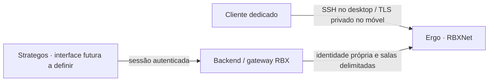

# Clientes IRC e papel do Strategos

Data: **2026-10-11**. Estado: **recomendação e roteiro de piloto**, sem instalação,
troca de cliente, criação de conta ou mudança de serviço. Complementa a
[arquitetura local](README.md) e o [roadmap](ROADMAP.md). O operador relata que,
após muito tempo aberto, o Halloy deixa de mostrar atualizações dos canais e
volta a mostrá-las ao fechar e reabrir a janela. O sintoma foi relatado, mas a
causa não foi reproduzida; não há comparação de estabilidade neste hardware.

## Recomendação

Usar clientes IRC dedicados para conversa cotidiana e acesso operacional.
Integrar salas e histórico ao Strategos como capacidade adicional, preservando
um cliente independente para diagnóstico quando o Strategos estiver indisponível.
Ambas as interfaces devem acessar a mesma RBXNet; não criar outra rede IRC ou
outro armazenamento de histórico só para trocar a interface.

| Dispositivo/interface | Candidato | Papel e condição |
| --- | --- | --- |
| Mint, interface gráfica | Konversation | Comparar com Halloy no mesmo túnel; adotar se atender estabilidade, reconexão e histórico |
| Mint, terminal | WeeChat | Alternativa operacional já prevista no repositório; não é requisito instalar dois clientes |
| POCO e Samsung | Goguma | Candidato móvel; depende de versão Android, caminho de rede e identidade própria |
| Strategos | Painel integrado futuro | Salas, histórico, alertas e referências a decisões, com autorização no backend |

O Ergo mantém o histórico documentado das salas por 30 dias, independentemente
de o cliente permanecer aberto. A experiência de consultar esse histórico
depende do cliente. A mailbox dos agentes continua separada das contas humanas;
nenhuma dessas interfaces transforma conversa em autorização para execução.

## Evidência local e escolha no Mint

Consulta somente leitura em 2026-10-11:

- `halloy --version`: **2026.9 (2b3edc8e)**, instalado no diretório do usuário.
- Configuração TOML consultada por lista explícita de campos: servidor
  `127.0.0.1`, porta `6667`, `use_tls=false`, `automated_chathistory=true`.
  O trecho sem TLS é loopback do túnel SSH; não é uma conexão IRC aberta pela LAN.
- `apt-cache policy`, sem atualizar índices: Konversation **23.08.5-0ubuntu4**
  e WeeChat **4.1.1-1build7**, sem instalação dos pacotes consultados. O cache
  local não demonstra a versão mais recente disponível nos servidores.
- Nenhum conteúdo de conversa, segredo ou comando de obtenção de senha foi
  exibido ou executado nessa inspeção.

A [página oficial do Konversation](https://apps.kde.org/konversation/) apresenta
uma GUI tradicional, TLS e releases recentes; também oferece distribuição via
Flathub. A versão upstream listada, **1.10.26082**, não é a versão do cache APT
local. Escolher uma distribuição estável e anotar a versão efetivamente testada.
Não presumir que a versão mais nova ou a disponibilidade no Mint prova estabilidade.

Konversation permite múltiplas redes simultâneas e identidades por servidor.
RBXNet pode coexistir com redes públicas, usando perfis e credenciais separados;
não configurar encaminhamento automático entre elas. As cores de conversa e
componentes associados são configuráveis, inclusive com fundo escuro. Menus e
botões dependem também da paleta Qt/KDE; no Cinnamon, validar a aparência do
pacote escolhido em vez de presumir que seguirá automaticamente o tema GTK.
Referência: [configuração de cores do Konversation 23.08.5](https://github.com/KDE/konversation/blob/v23.08.5/src/config/colorsappearance_config.ui).

Na leitura local de 2026-10-11, túnel e mailbox estavam `active/running`, com
`NRestarts=0` desde 2026-10-08. O socket da mailbox estava estabelecido no
loopback, e não foi encontrado processo chamado `halloy`. Esse retrato não
reproduz o período da falha nem comprova fluxo de mensagens ponta a ponta.
Ao ocorrer novamente, comparar conexão do cliente, atividade do túnel e
recuperação de histórico antes de fechar a janela. Hipóteses incluem conexão
sem recuperação, atualização visual e recuperação de histórico; nenhuma foi
confirmada. Não aplicar ajustes de GPU, DNS ou ping sem evidência correspondente.

O [Halloy documenta CHATHISTORY automático](https://halloy.chat/configuration/servers.html#automated_chathistory),
que já está habilitado aqui. A
[negociação atual do Konversation](https://raw.githubusercontent.com/KDE/konversation/master/src/irc/server.cpp)
não anuncia essa capacidade. Portanto, a migração pode mudar a navegação pelo
histórico, mesmo sem perder os dados retidos no Ergo. O
[manual do Ergo](https://github.com/ergochat/ergo/blob/v2.19.1/docs/MANUAL.md#history)
documenta recuperação por clientes modernos e consulta manual por `HISTORY`.

WeeChat segue como alternativa: há
[preparação local versionada](../../../infra/irc/weechat/README.md) e
[documentação oficial de TLS/SASL](https://weechat.org/files/doc/stable/weechat_user.en.html).
Não escolher HexChat para uma nova padronização: o autor anunciou
[2.16.2 como lançamento final](https://hexchat.github.io/news/2.16.2.html).
Não acrescentar um core Quassel ou bouncer à RBXNet apenas para ter clientes
móveis: esses componentes introduzem outro serviço e outra cópia de histórico.
O ZNC já previsto para redes públicas tem escopo distinto.

## Smartphones: aplicativo, transporte e identidade

[Goguma](https://goguma.im/) oferece interface móvel e histórico IRCv3. O projeto
identifica F-Droid como distribuição oficial e Play Store como comunitária.
O [pacote estável F-Droid consultado](https://f-droid.org/packages/fr.emersion.goguma/)
é **0.9.1**, para Android **7.0 ou superior**, incluindo ARM de 32 e 64 bits.
Confirmar a versão instalada nos dois aparelhos; o nome informado do POCO não
é evidência da versão Android.

O endpoint `127.0.0.1:6667` dos computadores não é um endereço que o telefone
possa reutilizar: loopback no telefone aponta para o próprio telefone. A conexão
móvel ainda precisa de um caminho aprovado. Para um cliente nativo, a proposta
é acesso privado pela malha RBX a um endpoint IRC com TLS válido, limitado pela
política da malha e pelas salas da conta. Esse endpoint e essas permissões não
foram demonstrados nem provisionados. Não abrir a porta 6667 no ZTE.

A [decisão de identidade](../../../infra/irc/docs/IDENTITY-CHATOPS.md) foi revista
em 2026-10-11 com concordância explícita do operador: o piloto pode usar senha
IRC própria e revogável por aparelho, inclusive no POCO, sem OPER e com salas
delimitadas. Não distribuir contas da mailbox nem a conta fundadora aos telefones.
Verificar como o cliente armazena e exporta credenciais; não presumir que a senha
esteja no cofre do Android. Testar revogação e tratar cópias locais do histórico.

POCO será o primeiro piloto; Samsung terá conta e escopo próprios. A aprovação
da direção de identidade não provisiona as contas nem o transporte. Instalar o
aplicativo, por si só, não entrega uma conexão funcional à RBXNet.

As [notificações do Goguma](https://codeberg.org/emersion/goguma/src/branch/master/doc/notifications.md)
dependem de execução em segundo plano ou push. Consulta periódica pode atrasar
sob restrições do Android. O
[Ergo 2.19.1 oferece push experimental](https://github.com/ergochat/ergo/blob/v2.19.1/docs/MANUAL.md#push-notifications),
desligado por padrão e dependente de conta always-on. Não foi verificada sua
configuração na RBX. Histórico recuperável não garante alerta imediato; não
adotar o celular como único destino de incidentes antes de medir esse comportamento.

## O que o Strategos oferece hoje e o que falta

O repositório local `strategos-ui/android/README.md` descreve o APK como entrada
que abre o navegador do sistema na interface web. Ele declara ausência de
conectividade IRC e de funcionamento nativo offline. Em `rbx-infra`,
[ROOMS-AND-HISTORY](../../../infra/irc/docs/ROOMS-AND-HISTORY.md#visualização-no-strategos)
registra explicitamente que o painel de salas ainda não está implementado.

Esse APK descreve o estado atual, não o padrão mobile definitivo. O operador
manteve **em aberto** o framework de Strategos, Robson e demais produtos RBX;
Tauri e Wails v3 serão avaliados em uma trilha própria do [roadmap](ROADMAP.md).
A autenticação/autorização do serviço e o transporte IRC devem permitir essa
escolha sem exigir a reconstrução da rede operacional.

Desenho futuro, não implantado por este roteiro:

O backend verifica usuário, tenant e sala antes de entregar histórico ou eventos.
A credencial do conector fica no servidor; não basta ocultar salas na interface.
O painel retoma o histórico por cursor, elimina duplicatas por ID e mostra
lacunas e expiração. A entrega inicial pode ser somente leitura. Publicação de
mensagens e qualquer ação operacional exigem contratos e permissões próprios.

Assim, o Strategos pode relacionar conversas a decisões e trabalho, enquanto o
cliente dedicado continua útil para conversa e diagnóstico. Decisões duráveis
continuam nos registros próprios dos sistemas e repositórios.

## Piloto e critérios de adoção

1. Reproduzir o sintoma relatado de atualização interrompida após longo uso,
   anotando período ocioso, suspensão e mudanças de rede. Separar falha da
   interface, túnel e servidor; não tratar a reabertura como diagnóstico da causa.
2. Preparar Konversation com autoconexão desativada, conta humana existente e
   o túnel loopback já validado. Preservar Halloy e suas configurações para retorno.
   Não iniciar outro túnel na mesma porta nem reiniciar o usado pelos agentes.
3. Comparar login, salas permitidas, histórico e reconexão nas mesmas condições.
   Testar fechamento/reabertura do cliente sem interromper a rede do escritório.
   Usar um cliente humano por vez para não introduzir colisões de sessão/nick;
   incluir tema escuro e uma segunda rede com identidade própria no piloto.
   Eventuais mensagens de teste dependem de instrução do operador para envio.
4. Registrar retenção/cache/logs locais separadamente dos 30 dias no servidor.
   Não ativar log bruto do protocolo por padrão; pode incluir credenciais e conteúdo.
5. No móvel, após identidade/transporte definidos, verificar recuperação de
   histórico, Wi-Fi ↔ dados móveis, tela bloqueada, reinício, atraso de alertas
   e revogação da conta. Primeiro POCO, depois Samsung se houver necessidade.
6. Adotar o cliente somente com evidência de uso e consulta de histórico
   satisfatórios. Manter a opção anterior até concluir essa avaliação.

Nenhum ensaio desses clientes, conexão móvel, envio de mensagem, inscrição na
malha ou mudança no Ergo foi executado para produzir este documento.
