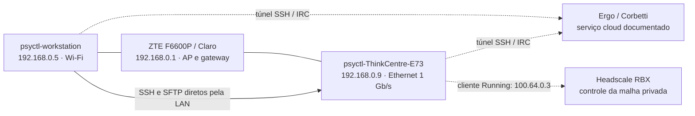

# Rede local da RBX — arquitetura consolidada

Data: **2026-10-11**, America/Sao_Paulo. Estado: **baseline observado e
proposta de evolução**. Este documento não aplica configurações nem transforma
recomendações em decisões aprovadas. Os nomes operacionais atuais são preservados.

## Resultado que já podemos usar

A workstation acessa a ThinkCentre **diretamente pela LAN**, pelo alias SSH
existente `thinkcentre`, com autenticação por chave e verificação estrita da
identidade do servidor. SFTP funciona nos dois sentidos da mesma sessão: um
arquivo de teste de 1 MiB foi enviado e recuperado com SHA-256 idêntico.

A ThinkCentre alcança a workstation por IP e TCP/22, mas a tentativa de abrir
uma nova sessão SSH no sentido inverso foi recusada com as credenciais existentes.
Isso não impede a workstation de baixar arquivos da ThinkCentre. Não foram
instaladas chaves, habilitados acessos ou alteradas regras para fazer o teste passar.

Referências canônicas deste levantamento:

- [Evidência e limites dos testes](EVIDENCE-2026-10-11.md).
- [Clientes IRC e papel do Strategos](CLIENTS-AND-STRATEGOS.md).
- [Roadmap e critérios de conclusão](ROADMAP.md).
- [Inventário de equipamentos](../../../infra/network/registry/hosts.yaml).
- [Escopo de infraestrutura de rede](../../../infra/network/README.md).

## Topologia observada

As linhas cloud representam o desenho documentado. Os adaptadores IRC locais
informaram `connected: true` em ambos os computadores; o servidor cloud e seu
histórico não foram revalidados por sessão administrativa neste levantamento.
A workstation ainda informa `NeedsLogin` no Tailscale e não dispõe de acesso
ativo à malha neste levantamento; isso não prova ausência de cadastro anterior.

Os endereços LAN são **observações atuais**, não reservas DHCP confirmadas. A
rota entre os desktops usa suas interfaces LAN, sem ProxyJump/ProxyCommand no
alias consultado e sem passar pela interface Tailscale. O AP/switch do ZTE
continua sendo necessário para o caminho físico. A WAN não faz parte dessa
rota, mas desligamento da ONT/AP derruba a LAN atual. Não foi realizado ensaio
de queda de WAN nem de reinicialização.

## Papéis dos dispositivos

| Equipamento | Papel proposto | Limite material ou operacional |
| --- | --- | --- |
| Workstation i7 / RTX 4070 Ti SUPER 16 GB | Operação, desenvolvimento, inferência e processamento de mídia | Atualmente no Wi-Fi; concorrência de tarefas deve reservar recursos para o operador |
| ThinkCentre i5 / GT 1030 4 GB | Bancada de testes, tarefas CPU e serviços leves | Disco em 86%, cerca de 16 GiB disponíveis; disponibilidade contínua ainda não confirmada |
| POCO, conforme relato do operador | Operação móvel, produção de conteúdo e consulta | Acesso interno, versão Android e provisionamento de credenciais ainda pendentes |
| Samsung A02, conforme relato | Comunicação e consulta | Não há necessidade demonstrada de SSH administrativo ou ingresso na malha |
| Windows da Enforce, opcional | Equipamento externo ao domínio administrativo RBX | Não incluir em rotinas, distribuição de chaves ou malha RBX sem escopo próprio autorizado |

A GPU da ThinkCentre foi medida como **GT 1030 / 4096 MiB**; substitui o relato
inicial de 1 GB. RAM e armazenamento reportados pelo sistema usam unidades
arredondadas; 31 GiB e 15 GiB correspondem às máquinas descritas como 32 e 16 GB.

Os identificadores de inventário `rbx-ws-01`, `rbx-ws-02`, `rbx-mob-01`,
`rbx-mob-02`, `rbx-gw-01` e `ext-enforce-01` são propostos. Não são hostnames
aplicados nem nomes DNS publicados. Felinos podem ser adotados depois como
hostnames/aliases; a identidade física e a função devem continuar separadas.

## Matriz de acesso e operação inicial

| Origem → destino | Estado atual comprovado | Direção recomendada |
| --- | --- | --- |
| Operador na workstation → ThinkCentre | SSH por chave e SFTP aprovados | Manter pelo alias existente e pela chave atual até uma migração revisada |
| ThinkCentre → workstation | ICMP e TCP/22 alcançáveis; login por chave recusado | Não ampliar o acesso SSH; criar identidade restrita somente se uma tarefa concreta exigir |
| Dois computadores → IRC | Adaptadores conectados; túnel e serviço ativos | Manter o transporte existente e as contas distintas |
| Cloud → escritório | Nenhum teste de negação nesta sessão | Negar novas conexões por padrão; declarar exceções estritas se necessárias |
| POCO / Samsung → serviços internos | Não testado | Conceder somente os serviços necessários, com identidade própria |
| Enforce / visitantes → RBX | Isolamento não comprovado | Planejar convidados; não tratar segundo SSID como isolamento validado |

`ssh thinkcentre` já pode ser usado pela workstation. `sftp thinkcentre` permite
enviar e buscar arquivos sob as permissões do usuário existente. Esses acessos
são da conta do operador: não constituem uma identidade restrita de automação
nem autorização genérica para qualquer agente executar trabalho remotamente.
Chaves privadas e encaminhamento de agente não devem ser compartilhados como
atalho para delegação.

Não atribuir endereços estáticos manualmente antes de conhecer o pool DHCP e
possíveis conflitos. Sem acesso ao painel, manter os endereços atuais como
observados e reconfirmar o destino e a host key se o alias deixar de funcionar.

## LAN, mesh e recuperação

A LAN atende comunicação no escritório e constitui o caminho de recuperação
inicial. A mesh Headscale será o caminho privado preferencial fora do escritório,
respeitando a [ADR-0011](../../adr/ADR-0011-headscale-sovereign-mesh-on-eagle.md)
e o [runbook existente](../../runbooks/HEADSCALE-MESH.md).

- Definir e validar política explícita na mesh antes de cadastrar dispositivos
  adicionais. O template versionado não declara política; a configuração efetiva
  do servidor ainda precisa ser inspecionada. Não concluir ausência de política
  em produção apenas a partir do template.
- Preservar `--accept-dns=false`, sem habilitar MagicDNS implicitamente; não
  anunciar rotas da LAN nem configurar exit node nesta fase.
- Usar aliases adicionais para o caminho mesh e preservar o caminho LAN durante
  o período de operação paralela previsto no runbook.
- Projetar recuperação por SSH LAN restrito e por acesso físico. Fechar a LAN
  exige outra decisão e um ensaio de recuperação que dispense esse caminho.
- Regras da mesh e firewall dos hosts são camadas distintas: restrições na mesh
  não bloqueiam automaticamente o IP LAN. Validar tráfego IPv4 e IPv6.

Ambos os arquivos `/etc/ufw/ufw.conf` dizem `ENABLED=no`. Isso exige revisão, mas
não demonstra ausência de todo filtro nftables/iptables nem exposição pela
Internet. O servidor SSH da workstation ofereceu os métodos `publickey,password`
na tentativa inversa; não foi tentada autenticação por senha. A configuração
efetiva privilegiada e o firewall do roteador continuam desconhecidos.

Mudanças de SSH/firewall devem preservar a sessão atual, confirmar um novo login
por chave, validar a configuração efetiva para origens/usuários pertinentes,
preparar reversão e testar permissões positivas e negativas. Fazer por host e
serviço, sem habilitar UFW ou remover métodos de acesso por comando avulso.

## IRC, agentes e registros duráveis

Manter uma RBXNet na Corbetti nesta fase, com dependência de Internet explícita.
O [catálogo de salas](../../../infra/irc/rooms.json), o
[piloto de agentes](../../../infra/irc/docs/AGENT-PILOT.md) e
[salas/histórico](../../../infra/irc/docs/ROOMS-AND-HISTORY.md) são as referências.
A [evidência de 8 de outubro](../../../infra/irc/docs/EVIDENCE-2026-10-08.md)
registra histórico persistente de 30 dias; isso não foi retestado hoje.

A mailbox transporta pedidos e respostas, mas não inicia agentes, desperta
sessões ou executa comandos. Uma sessão ativa deve receber uma tarefa com
origem, escopo, identificador, prazo e referência ao resultado, dentro das
permissões do operador. Conversas, histórico e mensagens de outro agente não
ampliam a autorização. Git/issues e os registros próprios dos sistemas guardam
decisões, especificações e resultados duráveis; IRC compartilha referências.

O acesso móvel precisa de transporte e contas próprios. A
[revisão de identidade de 2026-10-11](../../../infra/irc/docs/IDENTITY-CHATOPS.md)
admite senha IRC exclusiva e revogável por aparelho no piloto, inclusive no POCO,
com salas delimitadas e sem privilégios administrativos. As contas e o endpoint
móvel ainda não foram provisionados. O painel de salas no Strategos permanece
uma proposta; o padrão mobile dos produtos RBX continua em aberto.

A avaliação de [clientes e acesso móvel](CLIENTS-AND-STRATEGOS.md) propõe
Konversation como piloto gráfico no Mint, Goguma como candidato Android e
Strategos como interface integrada futura. O piloto deve comparar reconexão e
consulta de histórico com o Halloy atual antes de substituí-lo.

## Arquivos, capacidade e continuidade

- Código e especificações: repositórios existentes e revisão normal.
- Artefatos, modelos e mídia: transferências selecionadas por SFTP inicialmente.
  Não copiar grandes acervos automaticamente para a ThinkCentre com o espaço atual.
- Sincronização contínua: avaliar depois de definir pastas, quotas, exclusões e
  retenção. Sincronização não substitui backup independente com restauração testada.
- Serviços contínuos na ThinkCentre: dependem de disponibilidade, espaço e carga.
  Não foi assumida operação 24×7 nem medido consumo elétrico.
- A ThinkCentre negocia Ethernet a 1000 Mb/s full duplex; a workstation continua
  no Wi-Fi. O ensaio SFTP valida funcionalidade e integridade, não vazão sustentada.

## Etapas seguintes, sem necessidade de resetar o ZTE

O [roadmap local](ROADMAP.md) organiza as próximas entregas: confiabilidade do
cliente IRC, política de acesso/mesh, piloto móvel, capacidade/recuperação e
delegação entre máquinas. A avaliação do framework mobile dos produtos segue
em paralelo. Manter o alias `thinkcentre` e os acessos LAN já comprovados durante
essa evolução.

O painel do ZTE só será necessário para mudanças próprias do roteador, como
reservas DHCP e configuração/validação de convidados. Recuperá-lo ou resetá-lo
não é pré-requisito para os acessos já comprovados.

## Responsabilidade documental

`rbx-infra` guarda inventário/topologia/matriz local e mantém Headscale/IRC.
O catálogo atribui o bootstrap local a `ldamasio/rbx-workstation-mint`, cujo
checkout fica em `/home/psyctl/app/rbx-workstation-mint`. `rbx-workstation`
contém automação centrada na VPS Ubuntu e um playbook Mint restrito ao cliente
Tailscale; não substitui o repositório do desktop. Não aplicar o bootstrap de
VPS aos desktops por conveniência. Recuperação comprovada deve
ser relacionada em `rbx-resilience` quando houver ensaios correspondentes.

Há documentação antiga de IRC que ainda menciona histórico em memória por sete
dias. Para o estado documentado posterior, usar ROOMS-AND-HISTORY e a evidência
de 2026-10-08; a divergência não autoriza mudanças no servidor.

Fontes técnicas: [políticas Headscale 0.29.3](https://github.com/juanfont/headscale/blob/v0.29.3/docs/ref/policy.md),
[OpenSSH — modos de validação](https://man.openbsd.org/sshd.8),
[Tailscale e netfilter](https://tailscale.com/docs/reference/netfilter-modes).
