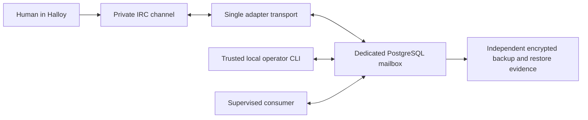

# PostgreSQL mailbox preparation and offline migration

Status: implementation and synthetic rehearsal, 2026-10-12. No live database,
adapter configuration, IRC service or human-query admission was changed.
Live cutover remains subject to the [destination preflight](POSTGRES-DESTINATION-PREFLIGHT.md).

## Decision and boundaries

Use RBX's ParadeDB/PostgreSQL standard for the adapter's durable operational
state. The mailbox uses PostgreSQL transactions and ordinary tables; it does
not require BM25, vector indexes or any ParadeDB extension. IRC history remains
a conversation record. It does not replace atomic claims, deduplication,
fencing, response state or uncertain delivery records.



The consumer prepares an answer separately. This change does not invoke a
model, connect subscriptions, integrate Thalamus, grant IRC execution rights
or make Flight Deck a running agent. `human_queries` remains false by default.

| Choice | Reason | Consequence |
|---|---|---|
| PostgreSQL as an explicitly selected backend | Match the RBX database standard and centralize operational state | Requires a verified private route, credentials, ownership and recovery evidence |
| One dedicated database and schema `irc_mailbox` per logical adapter | Keep identity and locking boundaries simple | `rbx-local` and `rbx-thinkcentre` require separate databases; no tenant multiplexing |
| Keep SQLite support for existing installations and regression tests | Preserve deployed behavior until a controlled migration | No automatic conversion or fallback, and no second active source of truth |
| Separate administrative initialization and runtime | Runtime does not need DDL privileges | Schema owner initializes; application role receives only required DML privileges |
| Explicit offline import and reconciliation hold | Preserve all state before deciding what may resume | Incomplete work blocks release; import never replays or resolves it |

These are operational guards for trusted local processes. Database credentials
are not tenant authorization, and a claim owner string is not authentication.
The configured agent/account/channel plus IRC server and TLS mode bind the
schema. Nick changes do not change the logical mailbox. Database/schema version
or identity mismatches fail closed.

## Connection and resource contract

Install the `postgres` extra (`psycopg[binary]==3.3.6`) into the adapter's own
environment. The existing installer accepts `local|thinkcentre postgresql`.
It prepares files and dependencies, preserves an existing configuration and
does not initialize a database, migrate data, read a secret or start a service.
Do not run it on an active installation before the maintenance plan is approved.

Add the following to the reviewed private configuration, retaining its existing
agent, peers, operator, channel and IRC endpoint settings:

```yaml
storage_backend: postgresql
database_url_env: RBX_IRC_DATABASE_URL
human_queries: false
```

`state_dir` remains required for configuration compatibility. PostgreSQL mode
does not create or use a local mailbox or bridge lock there. The environment
variable name is configuration; its value is a secret supplied through the
approved secret store. Do not put a real DSN in Git, IRC, arguments or logs.
Administrative commands can use the schema owner's secret through the same
environment reference; runtime must use its restricted application credential.

The DSN must explicitly contain host, database, user and SSL mode. Remote
connections require `sslmode=verify-full` with a trusted CA and matching DNS
name. Only explicit loopback endpoints permit `sslmode=disable`, for isolated
tests or a separately authenticated local tunnel. This exception does not
verify the remote end of a tunnel; that route needs its own evidence. Ambient
`PG*` variables and DSN service/hostaddr/options overrides are rejected. No
alternate-host list, automatic retry or local fallback is provided.

Use a direct PostgreSQL connection or a verified session-pooling path.
Transaction/statement pooling is incompatible with the daemon's session lock.
Each daemon holds one physical connection. A CLI/MCP operation opens one
connection per mailbox transaction; no pool is introduced. Connect and lock
timeouts are 5 seconds; statement and idle-transaction timeouts are 10 seconds.
These are per-connection, per-lock and per-statement limits, not a deadline for
an entire transaction. Several queries can exceed 10 seconds in total. Database
waits are synchronous and can block the IRC loop; network failure detection also
depends on libpq and the operating system. This implementation is intended for
low-volume supervised use, not a measured WAN latency or recovery target.
Measure database round trips, session counts, p95 response time and loss behavior
from the real host before acceptance. The IRC loop limits application output
to one frame per second, queue scans to once per second and heartbeat updates
to once per two seconds. Each transaction also validates schema identity and hold.

Every transaction takes the same transaction advisory lock, then evaluates
deadlines with a fresh clock. A separate session advisory lock admits only one
transport across hosts. Hosts must have synchronized UTC clocks; this change
preserves application-clock deadlines and does not substitute database time.
The same session's physical connection also executes the daemon's
transactions; losing that connection is fatal. A storage error is not swallowed
as malformed IRC input or handled as an IRC reconnect. The socket is closed
even when recording the disconnected heartbeat fails. The example systemd unit
uses `RestartPreventExitStatus=1`, so this failure needs operator attention.
Verify that the installed supervisor preserves that behavior.
Socket operations use `asyncio.timeout` so external cancellation remains
visible on Python 3.11 as well as 3.12. A deterministic regression test covers
socket drain completing concurrently with cancellation; transport tests also
bound shutdown and verify ownership release.

## Provision and initialize only after preflight

Provision a dedicated database, schema owner and non-owner runtime role through
reviewed RBX IaC. Do not reuse another application's credentials or deploy a
production database inside k3s. Disable public access to the database, restrict
HBA/firewall and record approved clients, connection limits and secret references.
Do not grant the runtime role ownership, CREATE, superuser, role creation,
replication or privileges in other applications.

The following commands assume a private reviewed config and the selected
administrative credential delivered without printing it:

```bash
rbx-agent-irc --config /private/agent.yaml storage initialize
rbx-agent-irc --config /private/agent.yaml storage status
```

Initialization creates only an absent schema. An existing schema must already
have matching version and identity. It never adopts an unknown schema. Runtime
fails if initialization has not occurred. The initializer revokes PUBLIC
privileges on its schema, tables and sequences.

Minimum grants, with names substituted through the reviewed provisioner:

```sql
GRANT CONNECT ON DATABASE irc_adapter TO irc_runtime;
GRANT USAGE ON SCHEMA irc_mailbox TO irc_runtime;
GRANT SELECT, INSERT, UPDATE, DELETE ON ALL TABLES IN SCHEMA irc_mailbox TO irc_runtime;
GRANT USAGE, SELECT ON ALL SEQUENCES IN SCHEMA irc_mailbox TO irc_runtime;
```

Database-wide PUBLIC/CREATE/TEMP privileges, HBA and cross-database restrictions
belong to provisioning, not the application initializer. Future schema upgrades
must explicitly review their grants. Test the exact runtime credential, including
denied DDL and unrelated database access, before cutover. An application role
can alter its mailbox rows; holds are an operational safety mechanism, not a
defense against a compromised writer credential.

## Freeze, preserve and import

1. Complete the destination preflight and record maintenance owner, window,
   source configuration/revision, recovery copy, rollback criteria and RPO/RTO.
   Stop human admission and reconcile existing work where possible while the
   source remains authoritative. Do not open a new session for migration.
2. Stop and prevent restart of every source transport, CLI/MCP writer and
   consumer, including processes on another host. The importer cannot prove
   that an old SQLite process is stopped. Record this operator attestation.
3. Create a consistent SQLite snapshot using its backup API or `.backup`,
   after quiescence. Do not copy a live WAL database as a lone file. Place the
   snapshot in an owned private 0700 directory as a private regular file with
   no symlinks, hardlinks or WAL/journal sidecars. Keep it separate from the
   installed `state_dir/mailbox.sqlite3`; retain the original.
4. Verify integrity, calculate SHA-256, preserve the frozen source configuration
   and confirm the encrypted independent recovery copy. Restore that copy in
   isolation before touching the operational destination. A checksum alone is
   not a backup or authenticity certificate.
5. Initialize an empty destination with the matching identity, then import:

```bash
rbx-agent-irc --config /private/agent.yaml storage migrate-sqlite \
  --source /private/snapshot/mailbox.sqlite3 --source-sha256 <verified-sha256> \
  --confirm-quiesced
rbx-agent-irc --config /private/agent.yaml storage status
```

Peer-only legacy snapshots lack persisted IRC server/TLS identity. Such a
snapshot is rejected unless the operator verifies it against the frozen source
configuration and adds `--attest-legacy-transport`. This attestation is recorded;
the importer cannot infer it from the snapshot. Human-schema snapshots must
contain a matching stored transport identity.

The importer accepts the known five-table legacy schema or the complete human
schema. It validates exact schema structure, field types, identity, source hash
and inode stability. One transaction verifies an empty target, copies every
field, checks row counts and canonical content digests, advances identity
sequences transactionally and installs `migration_hold=reconciliation_required`.
IDs, message IDs, references, fragments, timestamps, heartbeats, claims, fence
counters, answers and delivery states are preserved. An active PostgreSQL
transport prevents import. No records are overwritten or upserted.

The returned report contains counts and checksums, not message payloads or
credentials. Keep it in the private recovery record. If commit acknowledgement
is lost, the result is uncertain: inspect `storage status` and the recorded source
hash before deciding anything. Do not rerun automatically or delete the target.
Successful import is not authorization to dispatch.

## Reconcile and release

`storage status` reads counts and migration metadata without expiring, purging,
claiming or sending work. Normal runtime commands reject a held database.
Release checks and hold removal happen atomically under both ownership locks.
The release command refuses:

- Any pending peer request, including a previously sent request eligible for retry.
- Any unsent peer frame.
- Any open human session or human request that is received, in progress or uncertain.
- Any human response/frame with pending or uncertain delivery.

Prefer a fully settled source. If imported state contains blockers, keep the
hold and preserve both snapshots. Review each correlated request with provider
and delivery evidence. Prepare a separate per-ID reconciliation change with
the operator; this release command deliberately offers no blanket cancellation,
claim reset, replay or payload-edit option. Do not delete uncertainty to clear
the gate. Absence of a visible IRC message does not prove absence of execution.

After the recorded reconciliation and verification:

```bash
rbx-agent-irc --config /private/agent.yaml storage release-migration --confirm-reconciled
```

Release records its time and resets the heartbeat to disconnected. It does not
start a service or enable human queries. Configure every allowed local process
for the same selected backend, preserve the old source offline, verify runtime
privileges and start only one transport through the approved rollout. A new
supervised Halloy acceptance test still needs its own bounded session.

## Failure and recovery

| Failure | Behavior and operator action |
|---|---|
| DB unavailable, TLS failure, lock/statement timeout | Fail closed; close IRC socket and inspect the dependency. No SQLite fallback or automatic storage retry. |
| Transport owner connection lost | Stop that transport. Another process may acquire the DB lock, but cannot establish whether an external effect already happened; inspect persisted uncertainty first. |
| Human response persisted, socket result unknown | Keep `output_uncertain`; no automatic retransmission. `socket_sent` never proves display or reading. |
| Peer delivery interrupted | Legacy correlated retries remain unchanged. They are not an exactly-once claim for external work. |
| Migration rejected before commit | Transaction rolls back data and sequence changes. Inspect status before another attempt; keep the source snapshot. |
| Commit acknowledgement lost | Outcome may already be committed. Inspect metadata/checksums; no blind retry. |
| Backup restored to an earlier point | Previously attempted frames may look pending again. Keep all publishers stopped, preserve later evidence, install/review a hold and reconcile before release. |
| Workstation offline | The database may retain work; it does not run the local executor or keep the IRC client online. |

Before PostgreSQL accepts new operational writes, rollback may return to the
frozen SQLite source after proving no new output or execution occurred and
stopping the PostgreSQL path. After new writes, switching back to the old SQLite
file can lose deduplication or repeat work. Preserve both states and reconcile;
there is no automated reverse migration or dual-write mode.

Cloud location alone does not prove resilience. Record encrypted independent
backup custody, WAL/PITR coverage, retention, key recovery, freshness monitoring,
last archive, isolated restore and observed RPO/RTO for the selected IRC database.
Do not inherit success from another application's restore. See the dated
[state-policy report](POSTGRES-DESTINATION-PREFLIGHT.md#state-policy-report).

## Repeatable synthetic verification

CI requires PostgreSQL tests against a pinned disposable PostgreSQL 16 image.
Local rehearsal also runs against ParadeDB 0.25.10 on PostgreSQL 16. Fixtures
require `RBX_IRC_TEST_POSTGRES_URL` to name an explicit numeric loopback port and
the seed database `irc_mailbox_test`; each test creates and drops only its own
random database. Do not forward a production database to this port or give the
fixture a production credential. Set `RBX_IRC_REQUIRE_POSTGRES=1` to make a
missing fixture an error; otherwise local PostgreSQL tests are skipped.

Coverage includes SQLite compatibility, restricted runtime grants, concurrent
claims, atomic answer/outbox rollback, fresh deadlines after lock waits,
exclusive transport, lost ownership with a real IRC fixture socket, snapshot
validation, complete migration, duplicate import, commit uncertainty and hold
release. This verifies code behavior with synthetic state. It does not establish
the live destination's TLS, backup, availability or Halloy behavior.

Local evidence on 2026-10-12: 259 adapter tests passed on Python 3.12.14;
37 isolated pilot tests passed. A separate run of 70 storage/migration tests
passed against PostgreSQL 16.15 with password authentication, matching CI.
All five PostgreSQL transport cases also passed on Python 3.11.17, including
the cancellation regression that fails with the previous timeout wrapper.
Every database container used synthetic disposable state; no installed mailbox
or service was connected. Independent review covered the backend, importer,
administrative release and socket closure on storage failure.

References: [Psycopg transactions](https://www.psycopg.org/psycopg3/docs/basic/transactions.html),
[PostgreSQL advisory locks](https://www.postgresql.org/docs/17/explicit-locking.html#ADVISORY-LOCKS),
[libpq TLS verification](https://www.postgresql.org/docs/18/libpq-ssl.html),
[SQLite backup API](https://www.sqlite.org/backup.html).
