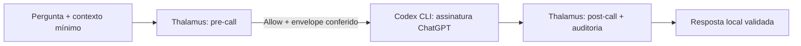

# Ensaios isolados da consulta a agentes

Esta pasta contém ferramentas de desenvolvimento. Não faz parte da instalação
do bot, não recebe mensagens do IRC e não mantém um atendimento ativo. O
contrato do atendimento continua em
[IRC-AGENT-QUERY-CONTRACT.md](../docs/IRC-AGENT-QUERY-CONTRACT.md).

## Contrato Thalamus

Executar com um binário confiável, construído a partir da revisão indicada na
[evidência](evidence/thalamus-probe.json), sem features de backend:

```bash
cargo build --locked --offline --package thalamus-server --no-default-features -j 2
```

O comando acima roda no checkout do Thalamus. No checkout de Infra:

```bash
python3 infra/irc/pilots/thalamus_probe.py --server-binary /caminho/absoluto/thalamus-server
python3 -m unittest discover -s infra/irc/pilots -p 'test_*.py' -v
```

O probe cria política e servidor temporários em loopback, com ambiente mínimo,
auditoria em memória e dados sintéticos. Verifica `/readyz`, `/v1/decide`,
`/v1/pre-call`, `/v1/post-call` e `/v1/audit/{id}`, e encerra o processo. Não
usa `/v1/call` ou provedor externo. A evidência guarda resultado e proveniência,
não uma cópia durável dos eventos do servidor.

Resultado observado em 2026-10-11, revisão `17fccd4`: uma execução simulada,
resultado `Valid` e dois eventos de auditoria com correlação conferida. Tenant
desconhecido foi negado pelo servidor. Post-call com ID órfão foi recusado.

Dois limites foram confirmados: `ConfigPolicyPort` aceita backend solicitado
desconhecido e orçamento solicitado maior que a política. O pre-call pode
selecionar outro backend e devolver os limites da política. O probe recusa
esses pedidos no cliente antes do mock, conferindo pedido e envelope completos.
Isso é uma barreira do probe, não evidência de negação pelo servidor. Não
generalizar esta política sintética como autorização institucional por ator.

`AllowWithReview`, decisões desconhecidas e envelopes adulterados são testados
no cliente com fixtures; a política JSON usada neste ensaio não produz revisão
pendente. O campo `executable_by_agent` no post-call não concede permissão para
executar comandos recebidos por IRC ou ações de produto.

## Executor Codex por assinatura

`codex_documentary.py` prepara uma consulta única via CLI oficial, com modelo
explícito, login forçado ChatGPT, ambiente restrito, prompt por stdin e sessão
efêmera. Não há fallback de autenticação, retry ou publicação em IRC. O processo
e seus descendentes são encerrados ao vencer o prazo, exceder a saída ou
aparecer evento de ferramenta. Erros não devolvem resposta parcial nem stderr.
Um único aviso literal da CLI sobre o host Code Mode intencionalmente
desativado é registrado como esperado, somente antes do turno. Variações,
repetições, aviso durante o turno e fallback para outras ferramentas são
recusados. O host continua desativado. A origem do aviso está na
[fonte oficial da versão fixada](https://github.com/openai/codex/blob/rust-v0.160.0/codex-rs/core/src/tools/code_mode/mod.rs).

A API Python fica fechada por padrão. `live_verified=True` é uma afirmação do
chamador confiável após conferir a configuração efetiva; não executa o preflight
e não pode ser derivada de uma mensagem ou classificação. O perfil pede leitura
apenas no diretório temporário, sem escrita ou rede para ferramentas. Revalidar
perfil, fontes de instruções, MCPs, provedor e autenticação a cada mudança de
versão/configuração antes de usar essa afirmação. Os MCPs e skills desativados
explicitamente correspondem ao inventário desta workstation; não representam
uma lista universal para outros hosts.

Os testes usam executáveis falsos e verificam isolamento de argumentos/ambiente,
versão, eventos, telemetria, limites e encerramento de descendentes. Uso de tokens
é medido depois da chamada; limites de tempo/bytes não impõem teto rígido de
tokens. Uma falha pode já ter consumido cota. `--ephemeral` impede persistência
da sessão, mas não promete ausência de escrita de caches/runtime/autenticação
pela própria CLI.

`subscription_trial.py` liga o pre-call ao executor e confere post-call e
auditoria antes de devolver a resposta local. Preserva uso conhecido se houver
falha após a chamada e não repete pedidos. O gate Python também fica fechado
por padrão; a [evidência do preflight](evidence/codex-preflight.json) registra a
inspeção humana/técnica desta versão, sem servir como autorização permanente.



O diagrama representa a consulta local de desenvolvimento. A mediação é da
execução completa da CLI; não desvia suas inferências internas por um gateway
Thalamus. A política é sintética e a auditoria do servidor fica em memória.
O atendimento permanente no IRC exige os contratos de sessão, identidade,
claims, retenção e encerramento descritos no documento principal.

O [ensaio real concluído](evidence/codex-subscription-trial.json) solicitou
`gpt-6.1-sol` pela autenticação ChatGPT existente. Uma consulta documental sobre
Action/Mission devolveu resposta em **9,653 s** na CLI, post-call `Valid` e dois
eventos de auditoria correlacionados. O prompt explícito tinha 2.191 bytes,
com trechos e revisão de Flight Deck, sem histórico da conversa ou canal.

Uso informado: **8.161 tokens de entrada**, incluindo **6.912 em cache**, e
**178 de saída**, total de **8.339**. Cache é subconjunto da entrada, não uma
parcela adicional. O total inclui o contexto nativo do executor; os 2.191 bytes
fornecidos não representam todo o prompt enviado pelo runtime. Não converter
esses números em desconto de cota ou economia percentual sem medição do plano
e uma referência comparável. O piloto IRC anterior não registrou consumo.

Três tentativas locais anteriores foram interrompidas sem resposta validada:
[transporte de MCP incompleto](evidence/codex-subscription-startup-failure.json),
[formato do aviso inicial](evidence/codex-subscription-event-failure.json) e
[aviso tratado conservadoramente](evidence/codex-subscription-warning-failure.json).
As correções foram verificadas antes da tentativa seguinte; não houve retry
automático ou fallback de autenticação. As falhas não informaram uso; não
contabilizá-las como economia ou consumo comprovadamente zero.

O teste registra um resultado local, sem publicar em IRC, chamar o produto
Flight Deck ou instalar o atendimento. O processo Thalamus e o executor foram
encerrados. Auditoria institucional durável, mediação por inferência e limites
de cota compartilhada permanecem pendentes.

## Laya em português

A [avaliação local](evidence/laya-evaluation.json) usou 32 casos sintéticos,
quatro classes, duas passagens, CPU com duas threads e inferência sem rede.
Código, dependências e cinco arquivos do checkpoint foram fixados e verificados
por hashes no [manifesto](laya-runtime.json). Não houve instalação no Python do
sistema ou alteração de serviço. O [relatório de reprodução](LAYA-EVALUATION.md)
descreve preparação, isolamento e limites da medição.

| Medida | Regras simples | Laya multilíngue |
| --- | --- | --- |
| Acertos nesta amostra | 29/32 (90,6%) | 8/32 (25%) |
| Macro-F1 | 0,905 | 0,206 |
| Erros de fora do escopo para documental/análise | 1 | 1 |
| Latência quente p50 / p95 | Ver tempo total na evidência | 221,5 / 230,9 ms |
| Pico de memória do processo completo | Não medido separadamente | 2,28 GiB |

Não adotar Laya no encaminhamento operacional nesta configuração. O resultado
não foi explicado por truncamento; aumentar o limiar para 0,8, definido antes
do ensaio, reteve oito casos e acertou três. As classes e os exemplos têm rótulos
provisórios, escritos pelo mesmo agente que preparou o baseline; esta amostra
não estabelece desempenho geral em português nem precisão no tráfego real.
Nenhum dos dois classificadores pode conceder autorização.

O destino de um alias explícito já foi resolvido sem inferência. Qualquer
experimento futuro de prompt/treino deve usar conjunto de desenvolvimento e
novos casos reservados, sem apresentar ajuste aos 32 exemplos como nova
validação independente.

## Limites de aceitação

Uma execução local delimitada não comprova controle de cada inferência interna
do executor, persistência de auditoria, autenticação institucional, reserva de
cota compartilhada ou prontidão para serviço contínuo. Essas propriedades
precisam de testes próprios antes da integração operacional.

Nenhuma ferramenta desta pasta concede autorização com base em classificação
de texto. Alias explícito resolve o destino deterministicamente; conta, canal,
sessão, permissões e orçamento continuam sendo verificações independentes.
